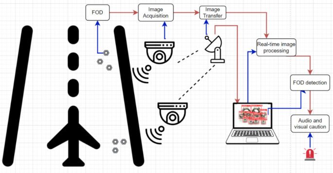

# Airport Runway Foreign Object Debris Detection

This repository contains the coursework implementation for a machine-vision system that detects Foreign Object Debris (FOD) in airport runway and taxiway images using deep learning.

## Research question

> How reliably can a lightweight deep-learning model detect airport Foreign Object Debris of different sizes across runway lighting and weather conditions when evaluated using a sequence-aware, leakage-resistant data split?

## Conceptual operational context



*Figure: User-provided conceptual workflow showing how runway cameras, image transfer, real-time processing, FOD detection and operator warnings could form a complete operational system.*

This diagram provides the wider application context. The coursework prototype focuses on the central image-processing and FOD-detection components using the available still-image dataset; it does not claim to implement live camera transfer or an operational airport alarm system.

## Intended system

The system will accept a runway image and return the location and confidence of detected debris. The initial implementation will treat all 31 source categories as a single `FOD` class so that the project focuses on reliable hazard localisation rather than fine-grained object naming.

The implementation will combine selected machine-vision techniques with a lightweight deep-learning object detector:

- Intensity and contrast analysis across bright, dim and dark images
- CLAHE as a controlled local-contrast preprocessing experiment
- Edge and small-object visibility analysis
- Thresholding and morphology as a conventional baseline
- Multiresolution analysis for small debris
- Lightweight YOLO-based object detection

## Dataset

The project uses **FOD-A Version 2.1 in Pascal VOC format**, published by the University of Nebraska at Omaha Aviation Institute.

- 33,793 RGB images at 300 x 300 pixels
- 33,793 Pascal VOC XML annotation files
- 34,472 annotated objects from 31 source categories
- Dry and wet pavement labels
- Bright, dim and dark lighting labels

Official sources:

- [FOD-A dataset repository](https://github.com/FOD-UNOmaha/FOD-data)
- [FOD-A publication](https://arxiv.org/abs/2110.03072)

The downloaded dataset is kept locally in `FOD-A Dataset/` and is intentionally excluded from Git.

The field definitions, environmental-code meanings, annotation conventions and derived analysis variables are documented in the [data dictionary](data/DATA_DICTIONARY.md). Importantly, the dataset publisher defines bright, dim, dark, dry and wet as qualitative categories and does not publish numerical lux or surface-moisture thresholds.

## Dataset audit

The local audit confirmed that all images and XML annotations are readable and that all bounding boxes are valid. It also identified problems in the supplied partition files:

- Four image IDs occur in both training and testing
- Split files contain repeated entries
- Seventy images are absent from both supplied partitions
- Visually similar sequential frames cross the supplied partitions
- Debris category is associated with weather and lighting
- 9,057 objects occupy less than one percent of the image

The project will therefore create a sequence-aware split before training. Aggregate performance will be supplemented with object-size, lighting and weather analyses, with particular attention to missed detections.

## Repository status

The dataset audit, leakage-resistant partitioning, exploratory analysis, annotation conversion and taught-technique analysis stages are complete. The verified split contains 23,602 training, 5,111 validation and 5,080 test images in 571 isolated sequence groups. The EDA confirms 9,852 small, 15,960 medium and 8,660 large objects, alongside meaningful category associations with lighting and weather. All 34,472 source objects have been converted to the single model class `0: FOD`. The preprocessing evidence retains original images as the model baseline and mild Gaussian or median filtering only as controlled variants. The YOLOv8n MPS training pipeline has passed an end-to-end smoke test; full baseline training is the next compute-intensive step.

## Repository structure

```text
.
├── audit/                 # Dataset-integrity audit and its verified summary
├── configs/               # Version-controlled experiment configurations
├── data/
│   ├── README.md          # Local dataset layout and provenance
│   └── splits/            # Generated split manifests (ignored by default)
├── notebooks/             # Numbered coursework and exploratory notebooks
├── reports/
│   ├── figures/           # Figures intended for the report
│   └── tables/            # Tables intended for the report
├── scripts/               # Thin command-line entry points
├── src/fod_detection/     # Reusable project code
│   ├── data/              # Parsing, validation and split construction
│   ├── preprocessing/     # Classical machine-vision transformations
│   ├── models/            # Training and inference code
│   └── evaluation/        # Metrics and condition-aware analysis
└── tests/                 # Automated checks for reusable code
```

The downloaded dataset remains in the local `FOD-A Dataset/` directory and is not committed. Generated datasets, split manifests, model weights and experiment runs are also ignored. Code, configuration, documentation and final report-ready results should be version controlled.

## Planned workflow

1. Audit and validate the Pascal VOC images and annotations.
2. Construct and verify a sequence-aware, leakage-resistant split.
3. Convert the annotations to the single-class YOLO format.
4. Analyse object size, lighting, weather and classical visibility cues.
5. Train and evaluate a lightweight object-detection baseline.
6. Run controlled preprocessing and robustness experiments.
7. Export reproducible figures, tables and notebook evidence for the report.

## Reproduce the corrected split

From the repository root, install the project and run:

```bash
python -m pip install -e '.[dev]'
python scripts/build_leakage_resistant_split.py
python scripts/verify_split.py
pytest
```

The splitting rule combines consecutive image IDs, matching weather and lighting, matching source labels and adjacent-frame perceptual similarity. A difference-hash distance of 16 retains 98.65% of adjacent pairs whose metadata matches while breaking visually discontinuous runs. Assignment occurs at sequence-group level within each available weather-light combination.

The frozen manifests and full verification summary are stored in `data/splits/final/`.

## Reproduce the exploratory analysis

```bash
python -m pip install -e '.[dev,analysis]'
python scripts/run_eda.py
jupyter nbconvert --to notebook --execute --inplace notebooks/01_exploratory_data_analysis.ipynb
```

The executed notebook is stored at `notebooks/01_exploratory_data_analysis.ipynb`. Its report-ready figures and compact evidence tables are stored under `reports/figures/eda/` and `reports/tables/eda/`.

## Reproduce the YOLO conversion

```bash
python scripts/convert_voc_to_yolo.py
python scripts/verify_yolo_conversion.py
```

The generated `data/yolo/` directory is local and ignored by Git. It contains copied images, single-class YOLO label files and `dataset.yaml`; the original JPEG and XML files remain unchanged. The repository retains the conversion code, verification summary and visual box check.

The leakage-resistant split places the dataset's single 679-image multi-object sequence entirely in training. Validation and test therefore assess single-object frames only; this is recorded as a dataset limitation rather than weakening sequence isolation.

## Reproduce the preprocessing analysis

```bash
python scripts/run_preprocessing_analysis.py
```

The analysis uses one representative small object per capture sequence and compares local contrast, edge energy and surrounding variation. The executed notebook is stored at `notebooks/03_preprocessing_analysis.ipynb`, with figures and tables under `reports/figures/preprocessing/` and `reports/tables/preprocessing/`.

## Baseline training

The version-controlled protocol is documented in `docs/BASELINE_TRAINING.md`, and the configuration is stored in `configs/yolov8n_baseline.yaml`.

```bash
.venv-train/bin/python scripts/check_training_environment.py
.venv-train/bin/python scripts/train_baseline.py --smoke-test
.venv-train/bin/python scripts/train_baseline.py
```

The smoke test verifies data loading, single-class model construction, MPS backpropagation, validation and checkpoint saving. Its metrics are deliberately excluded from the research results because one epoch on 32 training images is not a meaningful experiment.
